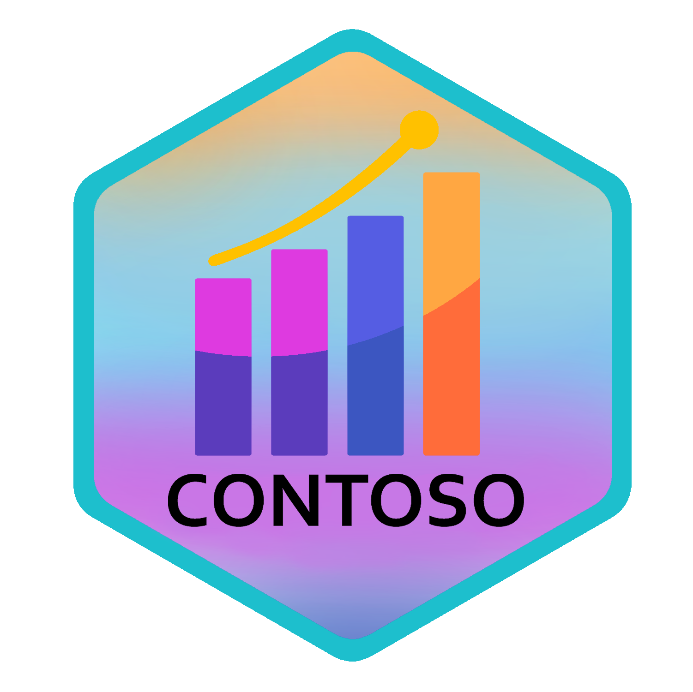
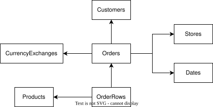

<!-- badges: start -->

<a href="https://CRAN.R-project.org/package=contoso"></a>
<!-- badges: end -->



Contoso is a synthetic dataset containing sample sales transaction data
for the fictional “Contoso” company. It includes various supporting
tables for business intelligence, such as customer, store, product, and
currency exchange data.

This dataset is perfect for practicing time series analysis, joins,
financial modeling, or any business intelligence-related tasks.

It comes with a built-in dataset as well as the ability to create an
in-memory database with [duckdb](https://duckdb.org/)

The package comes with the following tables:

- **sales**:
  - Contains information about sales transactions, including the total
    sales amount, customer, store, and product involved.
- **customer**:
  - Contains details about customers, such as customer key, name,
    address, and demographic information.
- **store**:
  - Contains information about stores, including store key, name,
    location, and related details.
- **product**:
  - Contains information about products, such as product key, name,
    category, and price.
- **fx**:
  - Contains foreign exchange rate data, mapping currency pairs to their
    exchange rates on specific dates.
- **calendar**:
  - Contains date-related information, including date, week, month,
    quarter, and year for use in time-based analysis.
- **orders**:
  - Contains information about individual orders, including order key,
    customer key, order date, and store information.
- **orderrows**:
  - Contains detailed line items for each order, including product key,
    quantity, and price for each item in the order.

Built into the package is the smallest version of the dataset: 7,794
sales lines across 3,242 orders and 3,165 customers.

Every column is documented in a machine-readable
[data-dict](https://data-dict.tidyverse.org/) dictionary, shipped with
the package. There is one per dataset, each in its own directory:
`extdata/small/` describes the bundled tables (and `size = "small"`),
`extdata/cloud/` describes the `medium`, `large` and `mega` sizes.

``` r
system.file("extdata", "small", "data-dict.yaml", package = "contoso")
```

Both validate against the spec, so the [`data-dict`
CLI](https://data-dict.tidyverse.org/) can check either against its
data, or render it as a browsable page. Point it at the directory:

Using `labelled::look_for()`, you can also see the columns’ labels from
the [labelled](https://larmarange.github.io/labelled/index.html)
package.

> Inspiration to using
> [labelled](https://larmarange.github.io/labelled/index.html) comes
> from [Crystal Lewis](https://cghlewis.com/blog/dict_clean/) excellent
> blog post

For larger datasets, use `create_contoso_duckdb()` with one of the
following sizes:

| Size   | Sales Rows  |
|--------|-------------|
| small  | 7,794       |
| medium | 2,349,091   |
| large  | 23,719,935  |
| mega   | 237,245,485 |

Column names and types are identical across all four sizes; only the row
counts differ.

## Data Storage

The larger datasets are stored as Parquet files on Cloudflare R2 cloud
storage and streamed directly into DuckDB via the public URL:

    https://pub-6aa63519a4b945948cb8c88949b320ca.r2.dev

## Source

The data is originally sourced from the
[sqlbi](https://github.com/sql-bi/Contoso-Data-Generator-V2-Data/releases/tag/ready-to-use-data)
github site

### Dataset overview



The relationship keys that join each of the tables are listed below.

| sales | customer | product | store | order | orderrows | fx |
|:---|:---|:---|:---|:---|:---|:---|
| order_key |  |  |  | order_key | order_key |  |
| customer_key | customer_key |  |  | customer_key |  |  |
| store_key |  |  | store_key | store_key |  |  |
| product_key |  | product_key |  |  | product_key |  |
| currency_code |  |  |  |  |  | from_currency |

### Installation

You can install the package from CRAN:

``` r
install.packages("contoso")
```

Or install the development version from
[Codeberg](https://codeberg.org/usrbinr/contoso):

``` r
# install.packages("remotes")
remotes::install_git("https://codeberg.org/usrbinr/contoso")
```

### Example

``` r
library(contoso)

# Create a DuckDB connection to Contoso datasets
db <- create_contoso_duckdb(size = "medium")

# Access the sales dataset
db$sales |> head()

# Launch the DuckDB UI to explore all tables interactively
launch_ui(db$con)

# Clean up when done
DBI::dbDisconnect(db$con, shutdown = TRUE)
```

### Business reports

The package also ships 1,127 fictional internal business reports about
Contoso’s trading from May 2016 to the end of 2025: weekly sales
flashes, monthly e-commerce, supply chain and plant reviews, quarterly
regional reviews, pricing committee minutes, operations notices,
industry notes and each year’s Annual Operating Plan, with a glossary of
the terms they use. Their figures come from the “mega” dataset, and a
few contain deliberate errors, for testing document search and FP&A
assistants.

``` r
reports <- read_reports() # one row per report, Markdown text in `body`
export_reports("contoso-reports") # or write them as one YAML file each
```

See the “Business reports” and “Searching the reports with ragnar”
articles on the [package
website](https://usrbinr.codeberg.page/contoso/).
